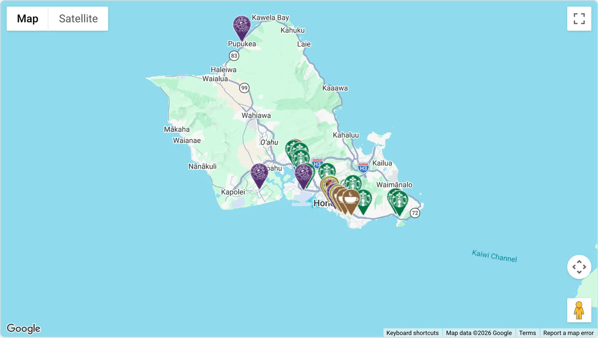

# @mapconductor/reactnative-for-googlemaps

MapConductor の Google Maps 用 React Native プロバイダーです。Web 用の
`@mapconductor/react-for-googlemaps` とは別パッケージで、Android の `com.mapconductor:for-googlemaps` と iOS の `MapConductorForGoogleMaps` を薄くラップします。

## デモ

[](https://demo-react.mapconductor.com/google-maps/map/en)

画像は Web 版（[`@mapconductor/react-for-googlemaps`](https://github.com/MapConductor/react-for-googlemaps)）の[ライブデモ](https://demo-react.mapconductor.com/google-maps/map/en)です。同じ店舗マップを React Native で書くと次のとおりです。

```tsx
import { useMemo, useState } from 'react';
import { Text } from 'react-native';
import {
  createGeoPoint,
  createMapCameraPosition,
  createMarkerState,
  type MarkerState,
} from '@mapconductor/js-sdk-core';
import { InfoBubble, Markers } from '@mapconductor/js-sdk-react/native';
import { GoogleMapDesign, GoogleMapView, useGoogleMapViewState } from '@mapconductor/reactnative-for-googlemaps';

const STORES = [
  { id: 'waikiki', name: 'Waikiki', latitude: 21.2793, longitude: -157.8292 },
  { id: 'kailua', name: 'Kailua', latitude: 21.3972, longitude: -157.7394 },
  { id: 'haleiwa', name: 'Haleiwa', latitude: 21.5928, longitude: -158.1034 },
];

const INITIAL_CAMERA = createMapCameraPosition({
  position: createGeoPoint({ latitude: 21.38, longitude: -157.93 }),
  zoom: 10,
});

export function StoreMap() {
  const mapViewState = useGoogleMapViewState({
    mapDesignType: GoogleMapDesign.Normal,
    cameraPosition: INITIAL_CAMERA,
  });
  const [selected, setSelected] = useState<MarkerState | null>(null);
  const markers = useMemo(
    () =>
      STORES.map(store =>
        createMarkerState({
          id: store.id,
          position: createGeoPoint({ latitude: store.latitude, longitude: store.longitude }),
          extra: store,
          onClick: marker => setSelected(marker),
        }),
      ),
    [],
  );

  return (
    <GoogleMapView state={mapViewState} style={{ flex: 1 }} onMapClick={() => setSelected(null)}>
      <Markers states={markers} />
      {selected && (
        <InfoBubble marker={selected}>
          <Text>{(selected.extra as (typeof STORES)[number]).name}</Text>
        </InfoBubble>
      )}
    </GoogleMapView>
  );
}
```
